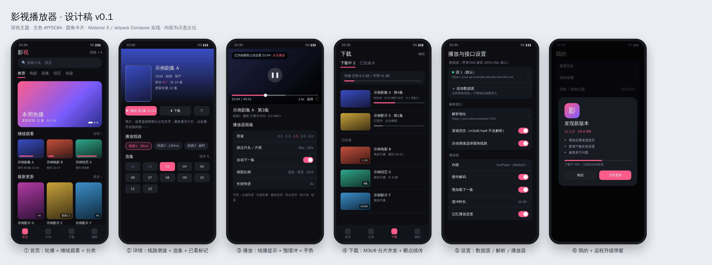
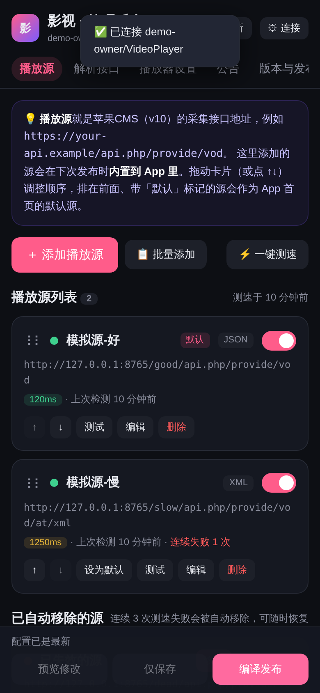
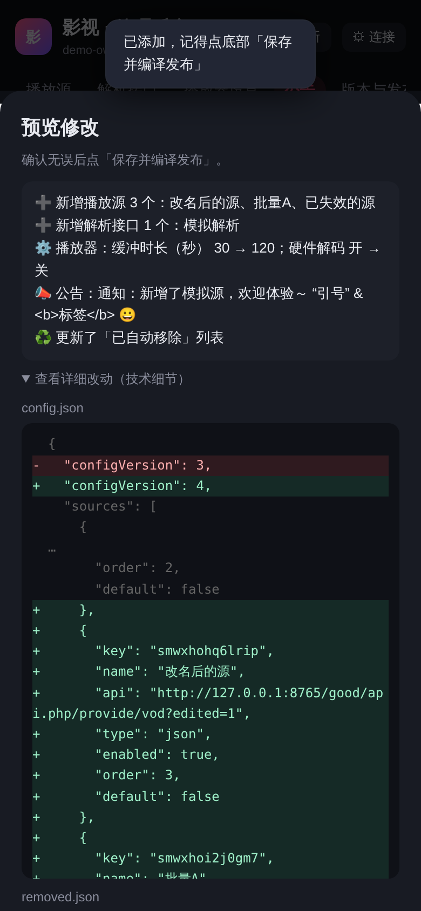

# 影视 · 通用视频播放器（Android）

> 一个干净、快速、不内置任何内容的安卓视频播放器。源由你自己配置，编译和更新全交给 GitHub，不需要服务器。



---

## 写在前面

我做这个项目，是因为市面上的「影视壳」大多有三个毛病：起播慢、广告多、配置一改就得重新折腾服务器。

所以我给它定了几条原则：

- **只做播放器，不碰内容。** App 里没有任何内置片源。它兼容苹果CMS v10 采集接口，接什么源由你决定。
- **快是第一位的。** 打开就出画面，点进详情页时播放器已经准备好，再次观看会自动跳回上次的位置。
- **不要服务器。** 配置、编译、发布、在线更新全部用 GitHub 完成：Actions 负责编译，Pages 做后台，Release 托管安装包。
- **小白也能维护。** 加源、改解析、发公告都在网页上点几下，不需要手改 JSON，也不需要会写代码。

> ⚠️ 本项目只是一个播放器外壳，不提供、不存储、不推荐任何影视资源。请只添加你有权使用的接口，并遵守所在地的法律法规。因使用者自行添加的内容产生的任何问题，与本项目无关。

---

## 它能做什么

**看得快**
- ExoPlayer（Media3）播放，首帧缓冲约 1 秒，支持硬解
- 直链（m3u8 / mp4 / flv）直接播放，不绕路；不是直链时，依次尝试解析接口，最后用 WebView 嗅探
- 打开详情页就开始准备播放器，看完一集前预加载下一集
- 接口和图片都做了多级缓存：先显示缓存内容，后台再刷新

**看得顺**
- 播放记忆：每 5 秒，以及暂停、切集、退到后台时都会保存进度，精确到每一集
- 0.5–3 倍速、长按 3 倍快进、跳过片头片尾（每部剧单独记）、自动下一集
- 手势：左边滑动调亮度，右边调音量，横滑拖动进度，双击暂停；还有锁屏、横屏全屏、画中画

**源自己管**
- 适配苹果CMS v10 的 JSON 和 XML 接口，支持多源切换
- 多条线路并发测速，自动选最快的线路
- 源连续 3 次测速失败会自动下架，随时可以恢复

**离线也能看**
- 多线程下载（1–16 线程）：M3U8 分片并发下载（支持 AES-128 加密），MP4 分块下载并支持断点续传
- 在后台下载，App 重启后自动继续；可以设置只在 Wi-Fi 下载

**其他**
- 收藏（有更新时显示角标）、观看历史、继续观看
- 搜索历史，分类筛选
- 深色、浅色或跟随系统；可选应用锁
- 在线更新：启动后在后台检查，不影响打开速度；下载后先校验 MD5 再安装

---

## 安装

### 我只想用 App

到本仓库的 [**Releases**](../../releases/latest) 页面下载最新的 `VideoPlayer-*.apk`，在手机上安装即可。系统提示「允许安装未知来源应用」时，选择允许。

装好以后，App 有新版本会自动提醒，也可以在「我的 → 检查更新」里手动检查。

> 第一次打开如果首页是空的，说明发布者还没有配置播放源。你也可以在「我的 → 播放与接口设置」里添加自己的源。

### 我想自己部署一份

整个过程大约 15 分钟，全程在浏览器里完成，不需要安装 Android Studio。

#### 第 1 步：把项目放到你的 GitHub

1. 在 GitHub 新建一个仓库（比如叫 `VideoPlayer`），**选择 Public（公开）**。私有仓库下，用户手机拿不到更新信息和安装包。
2. 进入仓库，点 `Add file → Upload files`，把解压后的所有文件拖进去，然后点 `Commit changes`。
   - 别漏了 `.github` 文件夹。在 macOS 的访达里，按 `Cmd + Shift + .` 可以显示隐藏文件。
3. 打开仓库的 **Actions** 页面。如果提示要启用工作流，点启用。

#### 第 2 步：配置签名（只做一次，很重要）

App 要能覆盖升级，每个版本的签名必须一致。

仓库 → **Settings → Secrets and variables → Actions → New repository secret**，添加以下 4 项：

| 名称 | 填什么 |
|---|---|
| `KEYSTORE_BASE64` | 签名文件 `release.jks` 转成的 Base64 文本（一整段，原样粘贴） |
| `KEYSTORE_PASSWORD` | 签名文件密码 |
| `KEY_ALIAS` | 别名，例如 `vplayer` |
| `KEY_PASSWORD` | 密钥密码（没有单独设置的话，和签名文件密码相同） |

<details>
<summary>还没有签名文件？点这里看怎么生成</summary>

需要电脑上装有 JDK：

```bash
keytool -genkeypair -v -keystore release.jks -alias vplayer -keyalg RSA -keysize 2048 -validity 36500

# 转成 Base64
base64 -i release.jks | tr -d '\n' > release.jks.b64                                   # macOS / Linux
[Convert]::ToBase64String([IO.File]::ReadAllBytes("release.jks")) > release.jks.b64    # Windows PowerShell
```

把 `release.jks.b64` 的全部内容填到 `KEYSTORE_BASE64`。
</details>

> 🔐 请把 `release.jks` 和密码保存在安全的地方，**不要上传到仓库**。签名文件一旦丢失，已安装的用户就只能卸载后重装。
> 如果没有配置签名，CI 仍然能编译，但每次用的都是临时签名，App 无法覆盖升级。

#### 第 3 步：打开网页后台

1. 仓库 → **Settings → Pages**：Source 选 `Deploy from a branch`，Branch 选 `main`，文件夹选 `/docs`，然后点 Save。
2. 等大约 1 分钟，打开 `https://<你的用户名>.github.io/<仓库名>/admin/`
3. 后台需要一个令牌才能修改仓库。到 [这里](https://github.com/settings/personal-access-tokens/new) 创建一个 **Fine-grained token**：
   - Repository access：选 **Only select repositories**，只勾选这个仓库
   - Permissions：**Contents** 设为 `Read and write`，**Actions** 设为 `Read and write`
4. 第一次打开后台时会弹出向导。填入仓库地址（直接粘贴仓库链接就行）和令牌，就完成了。

> 令牌只保存在你当前这个浏览器里，不会发到任何其他地方。

#### 第 4 步：添加源，一键发布



- **加源**：点「＋ 添加播放源」，填名称和地址，点「测试」看能不能连上。地址很多？用「📋 批量添加」，一行一个。
- **解析接口、播放器默认设置、公告**：分别在对应的标签页里填写。
- **测速**：点「⚡ 一键测速」，GitHub 会替你测一遍所有源，结果按速度排好序。
- **发布**：点「预览修改」，会用大白话列出这次改了什么。确认后点「**编译发布**」，大约 5–10 分钟后新版 APK 出现在 Releases，用户手机会收到更新提醒。



到这里就部署完了。🎉

---

## 它是怎么运转的

```
你在网页后台改配置 ──▶ 提交 config.json ──▶ GitHub Actions 编译签名
                                                   │
用户手机收到更新提醒 ◀── update.json ◀── 发布到 Releases
```

- **配置写死在每个版本里。** `config.json` 在编译时打进 APK，App 启动时不去联网拉配置，所以打开速度不受影响。改配置等于发一个新版本，用户通过在线更新拿到它。
- **自动巡检。** `source-check.yml` 每 6 小时测一遍所有源，按速度重新排序；连续 3 次失败的源会被移到 `removed.json`（后台可以一键恢复）。只有源列表真的变了，才会触发重新编译。
- **App 本机也会测速。** 用户网络和 GitHub 服务器的网络情况不同，所以 App 会按本机测速结果排序，并在本地隐藏连续失败的源。

### 版本号规则

| 怎么触发 | 版本名 |
|---|---|
| 推送 tag，比如 `v1.2.0` | `1.2.0` |
| 后台点「编译发布」，或 `config.json` 有改动 | `1.2.0-r57`（最近一个 tag 加上运行编号） |

`versionCode = 100 + 运行编号`，只增不减，在线更新据此判断是不是新版本。打正式版本的命令如下，tag 的说明会作为更新日志，多条用 `|` 分隔：

```bash
git tag -a v1.1.0 -m "起播速度提升|新增下载并发设置" && git push origin v1.1.0
```

---

## 进阶

<details>
<summary>不用后台，直接改 config.json</summary>

在仓库里打开 `config.json`，点铅笔图标编辑，然后 Commit。推送后会自动编译发布。

```json
{
  "configVersion": 2,
  "sources": [
    { "key": "s1", "name": "示例源", "api": "https://your-api.example/api.php/provide/vod",
      "type": "json", "enabled": true, "order": 1, "default": true }
  ],
  "parses": [
    { "key": "p1", "name": "示例解析", "url": "https://your-parse.example/?url=",
      "type": "json", "enabled": true, "order": 1 }
  ],
  "player": { "bufferSeconds": 30, "hwDecode": true, "preloadNext": true, "autoNext": true,
              "defaultSpeed": 1.0, "longPressSpeed": 3.0, "directFirst": true,
              "downloadConcurrency": 8, "maxDownloadTasks": 2 },
  "notice": { "enabled": false, "id": "notice-1", "title": "公告", "text": "", "link": "" }
}
```

- XML 接口的地址形如 `…/api.php/provide/vod/at/xml`，`type` 填 `xml`
- 解析接口的 `type`：`json` 表示接口返回 `{"url":"…"}`；`webview` 表示网页嗅探
</details>

<details>
<summary>在线更新地址和 update.json</summary>

App 按以下顺序查找 `update.json`（地址在编译时自动写入）：

1. `raw.githubusercontent.com/<用户>/<仓库>/main/update.json`
2. jsDelivr 镜像（国内更快，最长约 12 小时缓存）
3. Releases 里的 `update.json`

也可以在 `config.json` 的 `updateUrl` 里指定其他地址。国内下载 Release 慢的话，可以把 `apkUrl` 换成自己的镜像地址，App 会校验 MD5。

```json
{ "versionCode": 157, "versionName": "1.1.0",
  "apkUrl": "https://github.com/<用户>/<仓库>/releases/download/v1.1.0/VideoPlayer-v1.1.0.apk",
  "size": "18.4 MB", "changelog": ["起播速度提升"], "force": false, "md5": "…" }
```
</details>

<details>
<summary>App 内添加本地源 / 订阅导入</summary>

在「我的 → 播放与接口设置」添加的源只在本机生效，内置源只读。订阅导入支持以下格式：
`[{"name","api"}]`、`{"sources":[…],"parses":[…]}`，以及 TVBox 风格的 `{"sites":[…],"parses":[…]}`。
</details>

<details>
<summary>本地编译</summary>

需要 JDK 17 和 Android SDK 35：

```bash
./gradlew assembleDebug
./gradlew testDebugUnitTest      # MockServerTest 需要设置 MOCK_BASE，否则自动跳过
```
</details>

### 项目结构

```
app/src/main/java/com/vplayer/app/
  data/       苹果CMS 适配、缓存、数据库、测速
  player/     播放器、地址解析、线路测速
  download/   M3U8 / MP4 多线程下载
  update/     在线更新
  ui/         各个页面
config.json            App 配置（编译时打包）
update.json            更新信息（发布时自动更新）
docs/admin/            网页后台
scripts/               测速脚本
.github/workflows/     编译发布 / 定时测速
```

技术栈：Kotlin、Jetpack Compose（Material 3）、Media3 ExoPlayer、Room、WorkManager、Paging 3、OkHttp、Coil、DataStore。

---

## 常见问题

**升级时提示「签名不一致」？**
说明之前没有配置签名。配置好第 2 步的 4 个 Secrets 后，卸载旧版、重装一次新版，以后就都能直接覆盖升级了。

**后台测试提示「浏览器无法直接访问」？**
很多接口不允许浏览器跨域访问，或者用的是 http 地址，这并不代表源不能用。点「⚡ 一键测速」，用 GitHub 服务器测出的结果为准。

**改了配置，用户多久能收到？**
编译需要 5–10 分钟。用户的 App 会在下次启动后约 5 秒自动检查更新（每天最多检查一次），也可以在「我的 → 检查更新」里手动检查。

**令牌安全吗？**
令牌只存在你的浏览器本地，权限也只限这一个仓库。建议设置过期时间；万一泄露，到 GitHub 设置里删掉即可。

---

## 已知不足

- 解析接口目前只支持两种：返回 JSON `url` 字段的，和网页嗅探。其他格式暂不支持。
- M3U8 下载会原样保存，不会去掉插播广告片段。
- 开启应用锁时，启动瞬间可能先闪一下首页。

欢迎提 Issue 和 PR。如果这个项目对你有帮助，点个 ⭐ 就是对我最大的鼓励。

## 许可

本项目仅供学习交流使用，代码按原样提供。内容与使用责任由使用者自行承担。
